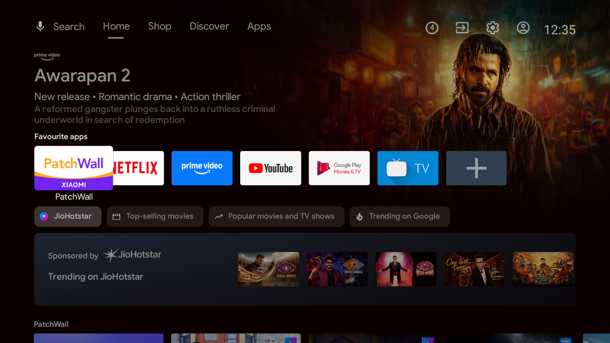
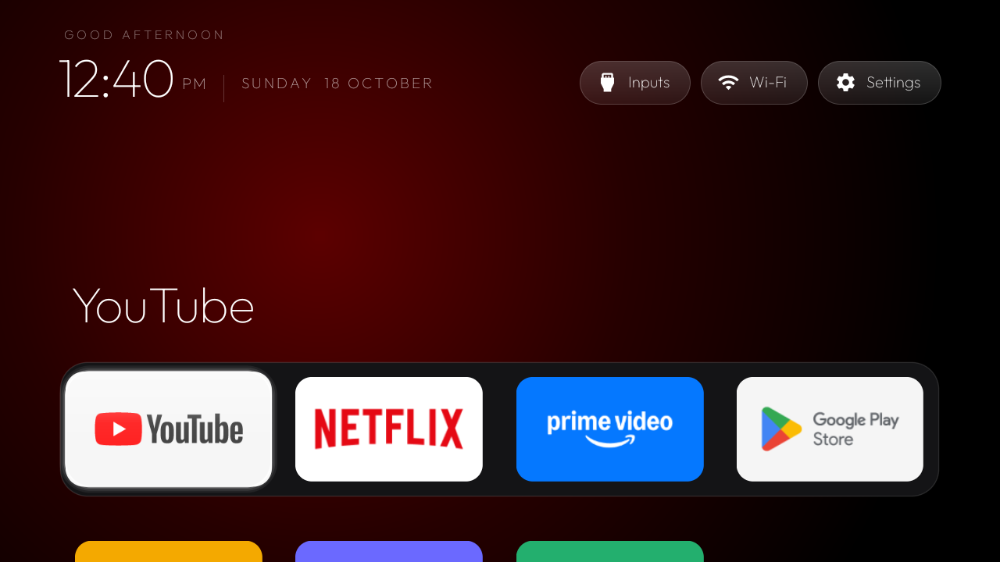
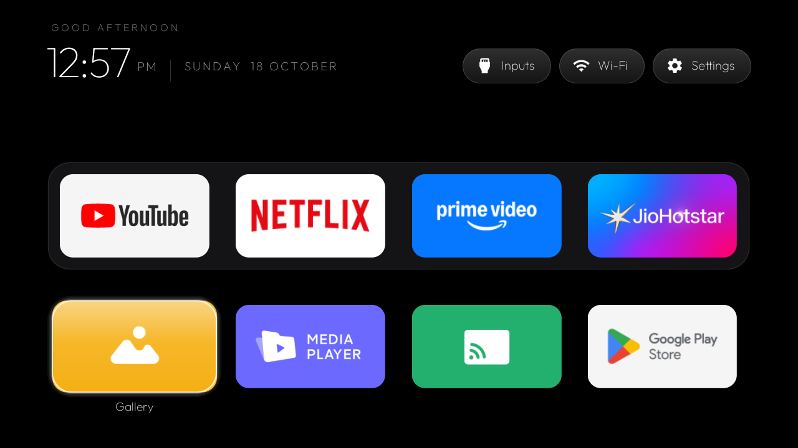
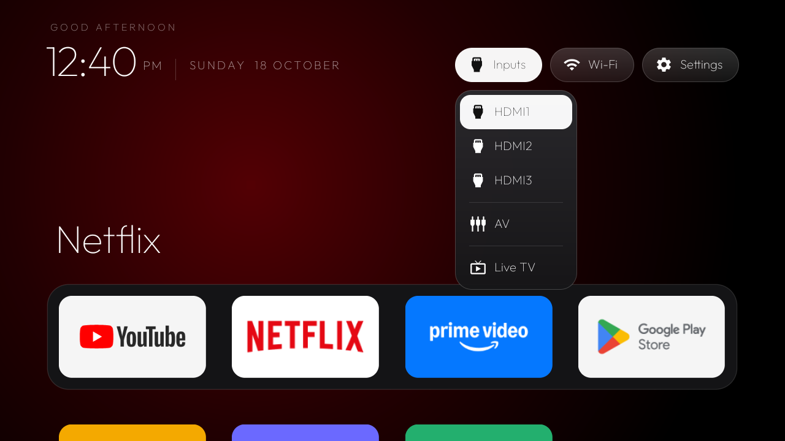

# MiTV-Debloat

Debloat for the Xiaomi Mi TV **MiTV-AXSO0** (codename `dangal`, Android TV 9, 1 GB RAM)
plus a clean, tvOS-style home screen.

> **Credits:** this is a fork of [**tv-vibehack** by Gathin23](https://github.com/Gathin23/tv-vibehack)
> (MIT). The prompt ([`PROMPT.md`](PROMPT.md)), the ADB tools and the tvOS-style launcher are their work.
> This fork only adds the debloat list and configuration for one TV, plus a few script fixes for Android 9.
> For other TVs, or to contribute, go to the original repo.

| Stock home | After |
|---|---|
|  |  |
|  |  |

Everything is reversible: packages are **disabled** for user 0, never uninstalled.

## What was done

- **Backup** of the package list, disabled list, `getprop` and all settings in `backup/<timestamp>/`
  (git-ignored: it holds the TV's serial and android_id).
- **Disabled** the 20 packages in [`examples/xiaomi-mitv-axso0/debloat.txt`](examples/xiaomi-mitv-axso0/debloat.txt):
  Xiaomi and Google telemetry, PatchWall and the recommendation and sponsored rows, Play auto-installs,
  the TV Manager cleaner, the handbook, the audio debug tool, Camera, the Google TV phone-remote service,
  Mi Music, Play Games, Play Movies, YouTube Music and the old Leanback launcher.
- **Kept on purpose:** MiLink (`com.mitv.milinkservice`, port 6091, used by the MiTV-Remote app),
  Chromecast, Miracast (Smartshare + WFD helper), Google Assistant, firmware updates, the USB media
  player/gallery and the Ambient screensaver.
- **Launcher** `com.gathin.tvhome` installed as the default home. The stock `com.google.android.tvlauncher`
  is disabled.
  Dock: YouTube, Netflix, Prime Video, JioHotstar. On a TV without JioHotstar (the second set), Play Store
  takes the 4th slot. Everything else is in the grid below.

## Scripts

Two identical MiTV-AXSO0 sets run this setup: `192.168.0.120` and `192.168.0.112` (same firmware). Run each command once per TV with its `TV_HOST`.

Every script takes `TV_HOST` (the first TV is at `192.168.0.120`, which can change with DHCP: check
`dscacheutil -q host -a name <cast-id>.local` or the router). They use the stock `adb` when it can reach the
TV and otherwise fall back to the pure-Python client in `tools/tv.py`, for when macOS Local Network
privacy blocks `adb`.

```bash
export TV_HOST=192.168.0.120
tools/disable.sh examples/xiaomi-mitv-axso0/debloat.txt   # apply the debloat
tools/restore.sh examples/xiaomi-mitv-axso0/debloat.txt   # undo everything, stock launcher back
launcher/build-and-install.sh                             # rebuild + install the launcher
printf 'pm list packages -d\n' | tools/tvbatch.sh         # run any shell commands, one per line
```

`build-and-install.sh` needs JDK 17 and the Android SDK (`~/Library/Android/sdk`; Gradle downloads
platform 34 on first build).

## Re-enable a single app

```bash
adb connect 192.168.0.120:5555
adb -s 192.168.0.120:5555 shell pm enable com.google.android.youtube.tvmusic
```

Then comment the package out in `debloat.txt` so a later `disable.sh` run leaves it alone.

## Change the dock, hidden apps or columns

Edit [`launcher/app/src/main/res/values/config.xml`](launcher/app/src/main/res/values/config.xml):

- `dock_apps`: package names in dock order. The dock has `columns` slots (4 fits this 1280×720 screen best).
- `hidden_apps`: apps never shown as tiles (Live TV is already in the Inputs menu).
- `live_tv_package`: `com.android.tv` on this set.

Then run `launcher/build-and-install.sh`.

The background is pitch black with a glow sampled from the focused dock app's banner. For a
different background, change `android:windowBackground` / the root background in
`launcher/app/src/main/res/values/styles.xml` and `res/layout/activity_main.xml`, then rebuild.

## Notes for this TV

- `cmd package set-home-activity` needs the full component on Android 9
  (`com.gathin.tvhome/.MainActivity`). The scripts already pass it.
- The Wi-Fi pill shows "Wi-Fi", not the network name. On Android 9, apps can read the SSID only with
  Location on, and this TV has no GPS or network location provider to turn on.
- The default keyboard is already Gboard, so the Baidu IME quirk from the Mi TV 4A doesn't apply.
- Network ADB on port 5555 works with just USB debugging on. There's no separate wireless-debugging toggle.

## Licence

MIT, see [`LICENSE`](LICENSE) (copyright the tv-vibehack author, kept as-is). The Outfit typeface is under the SIL OFL, see
`launcher/FONT-LICENSE-OFL.txt`.
